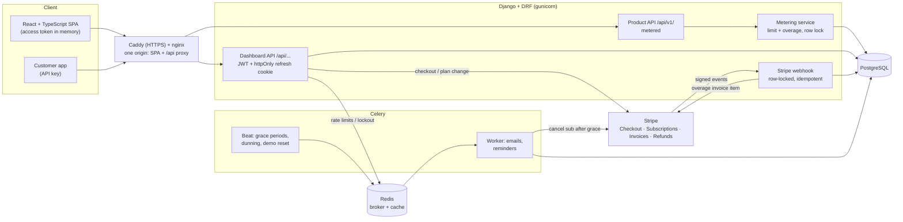
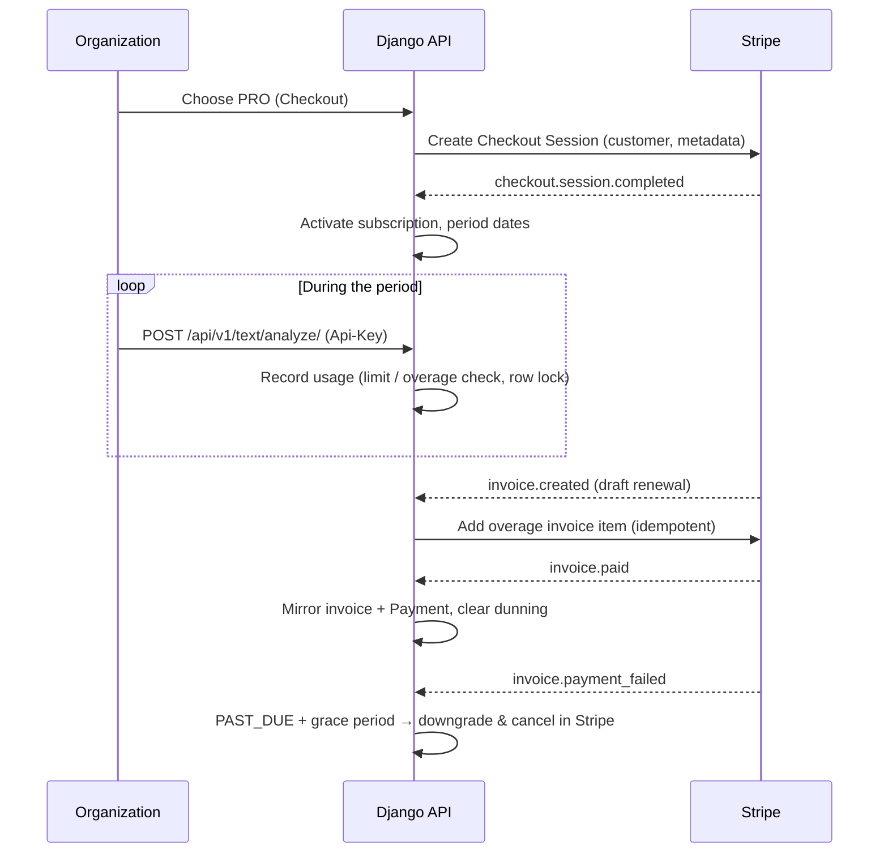
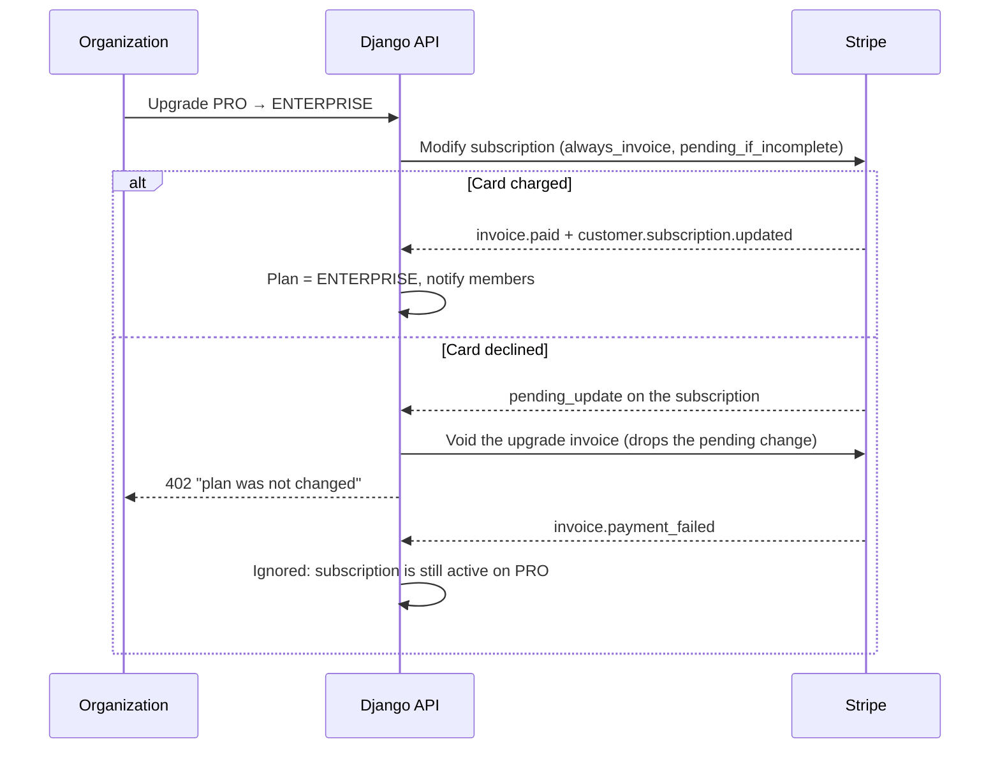

# SaaS Billing — Multi-Tenant Subscription & Usage-Based Billing Platform

[](https://github.com/MuhammadHaseeb3112/Multi-Tenant-SaaS-Billing/actions/workflows/ci.yml)


> **Live demo:** _link coming soon_ — one-click logins for Owner, Accountant
> and Member; Stripe in test mode (card `4242 4242 4242 4242`).
> Locally: `python manage.py seed_demo`, then sign in as `owner@demo.com`,
> `accountant@demo.com` or `member@demo.com` (password `DemoPass123!`).

A full-stack SaaS platform that sells its own API product and bills for it:
organizations subscribe to plans with **Stripe**, call a metered API with
**API keys**, get **usage limits and paid overage**, and manage invoices,
payments, dunning, team roles and analytics — with strict **tenant
isolation**. Each organization can also invoice **its own customers**, who
pay through a signed public link without an account.

**Stack:** Django 6 · Django REST Framework · PostgreSQL · Celery + Redis ·
Stripe · React 19 · TypeScript · Vite · Recharts · Docker


---

## What it does

| Area | Highlights |
|---|---|
| **Multi-tenancy** | Users belong to many organizations; every query is scoped by organization; role-based access (Owner, Admin, Accountant, Member) enforced in the API. |
| **Subscriptions (Stripe)** | Stripe Checkout for FREE / PRO / ENTERPRISE (monthly or annual), cancel / resume, one Stripe customer per org, blocks a second paid subscription (no double billing). **Upgrades are paid up front**: the prorated difference is charged immediately and the plan changes only if the payment succeeds (`pending_if_incomplete`); a declined card leaves the plan untouched. Downgrades switch at once with a credit. |
| **Webhooks** | Signature-verified, stored and **idempotent** (replays are safe). Handles checkout, `invoice.paid / payment_succeeded / payment_failed / created`, subscription updated / deleted. Compatible with Stripe API `2025-03-31+` invoice shape. |
| **Failed payments** | A failed renewal sets PAST_DUE with a 7-day grace period, then an automatic downgrade to FREE that also **cancels the Stripe subscription**. A declined upgrade charge does *not* start dunning. Scheduled reminders for overdue invoices (Celery Beat). |
| **Metered API product** | "Text Insights API" (`/api/v1/`) authenticated with hashed **API keys** (shown once, revocable). Every call is metered; limits enforced under a DB row lock (verified with concurrent requests). |
| **Usage-based billing** | Paid plans can go over their limit (price per 1,000 requests, safety cap). At renewal the overage of the closed period is added to Stripe's draft invoice — **never billed twice** (DB constraint + Stripe idempotency key). |
| **Invoices & payments** | Invoice CRUD with locked non-draft fields; tax-only or zero invoices are rejected; drafts can be deleted, issued invoices are voided. "Create & send" emails the invoice with a **signed public payment link** (`/pay/<token>`, no login); resending issues a new link and expires the old ones. Manual "mark as paid" / void, OVERDUE status. Stripe invoices mirrored locally; `Payment` ledger for Stripe and manual payments; backfill command. |
| **Invoice PDF** | WeasyPrint PDF with seller and "bill to" blocks, status badge (PAID / OPEN / OVERDUE / PARTIALLY REFUNDED / REFUNDED / VOID), paid date, and paid / refunded / net paid / amount due lines. |
| **Customer vs platform money** | Money a workspace collects from its customers is kept apart from the subscription fees it pays the platform: separate invoice tabs, separate analytics cards, and revenue charts that count customer payments only. |
| **Analytics** | Per-org MRR, collected from customers, paid to platform, awaiting payment, monthly revenue trend. Platform admin view: MRR, ARR, ARPA, plan mix, churn, revenue by method. |
| **Refunds & credit notes** | Stripe refunds (`refund.*`, `charge.refunded`) matched to the right payment via PaymentIntent → InvoicePayment; partial / full refunds; revenue is always net of refunds; credit notes mirrored. |
| **Security** | Refresh token only in an **httpOnly, SameSite cookie** (access token in memory, rotation + blacklist); **login brute-force lockout** (per IP+email and per email) and per-IP rate limits on auth endpoints; Origin check on cookie endpoints; hashed API keys. |
| **Accounts & team** | Profile and password change (revokes every other session), password reset by email (1-hour link, same answer whether or not the address exists). Email invitations with a locked, pre-filled sign-up, resend and cancel. |
| **Audit & notifications** | Audit log for sensitive actions (invoices sent / paid / deleted, API keys, manual usage, password changes, failed upgrades), **read-only** even in Django admin. In-app notifications for billing events with a live unread count. |
| **Responsive UI** | Every screen works at phone width: slide-in menu, fixed top bar, tables that scroll inside their own card. |
| **Production-ready ops** | Health/readiness endpoints, request IDs on every response and log line, JSON logs, DB connection reuse, WhiteNoise static files, gunicorn config, non-root containers, single-origin nginx + Caddy (auto-HTTPS) deploy, nightly demo reset. |

## Screenshots

| Usage, API keys & overage | Analytics |
|---|---|
|  |  |
| **Invoices** | **Plans** |
|  |  |

## Architecture



### Billing lifecycle



### Plan upgrade (paid before it applies)



## Project layout

```
saas_billing_backend_api/     Django project
  apps/
    accounts/       custom user, JWT auth
    tenants/        organizations, memberships, roles, invitations
    billing/        plans, subscriptions, Stripe checkout, grace periods
    invoices/       invoices, PDF, payments ledger, dunning
    usage/          API keys, metering, overage billing, product API
    webhooks/       Stripe webhook processing
    analytics/      org + platform analytics
    audit/          audit log
    notifications/  in-app notifications
  config/           settings (base / development / production), Celery
saas_billing_frontend/        React + Vite dashboard
docs/                         deployment guide, screenshots
```

## Run it locally (Docker)

Requirements: Docker Desktop, a Stripe **test** account, Node 20.19+ (22 LTS recommended).

```bash
# 1. Backend
cd saas_billing_backend_api
cp .env.example .env             # Windows: copy .env.example .env  — then fill it in
docker compose up -d --build     # postgres, redis, web, celery, celery-beat, stripe-cli
docker compose exec web python manage.py migrate
docker compose exec web python manage.py createsuperuser

# 2. Frontend (Vite proxies /api to Django: same origin, no CORS)
cd ../saas_billing_frontend
npm ci
npm run dev                      # http://localhost:5173

# Optional: realistic demo data (3 roles, 2 orgs, 6 months of customer
# invoices and payments, a refund, usage). Add --reset to rebuild it.
docker compose exec web python manage.py seed_demo
```

Then in Django admin (`http://localhost:8000/admin/`) create the plans
`FREE`, `PRO`, `ENTERPRISE` with their Stripe price IDs, API limits and
(optionally) overage price per 1,000 requests.

Stripe webhooks are forwarded by the `stripe-cli` container; get its signing
secret once with
`docker compose run --rm stripe-cli listen --api-key <sk_test_...> --print-secret`
and put it in `.env` as `STRIPE_WEBHOOK_SECRET`. Add `web` to
`DJANGO_ALLOWED_HOSTS` so the forwarded events are accepted.

Code is baked into the images: after changing backend code run
`docker compose up -d --build web celery celery-beat` (a plain restart
keeps the old code).

### Call the metered API

Create a key on the **Usage** page (Owner/Admin), then:

```bash
curl -X POST http://localhost:8000/api/v1/text/analyze/ \
  -H "Authorization: Api-Key sbk_..." \
  -H "Content-Type: application/json" \
  -d '{"text": "Invoices were paid on time."}'
```

Responses carry `X-RateLimit-Limit`, `X-RateLimit-Remaining`,
`X-RateLimit-Reset` (and `X-Overage-Requests` in overage). Over the limit
without overage → `429`.

## Tests

```bash
cd saas_billing_backend_api
docker compose exec web pytest -q      # 551 backend tests

cd ../saas_billing_frontend
npm test                               # 104 frontend tests (Vitest + Testing Library)
```

Stripe is mocked in tests. Bug fixes come with regression tests that fail
on the old code. CI (GitHub Actions) runs the backend suite against
PostgreSQL, checks for missing migrations, and lints, tests, type-checks
and builds the frontend. Concurrency is tested for real: parallel
requests against a usage limit, and two simultaneous deliveries of the
same Stripe webhook (processed exactly once).

## API overview

All dashboard endpoints use JWT (`Authorization: Bearer ...`) and are scoped
by `organization_id`.

| Area | Endpoints |
|---|---|
| Auth | `POST /api/auth/register/`, `login/`, `token/refresh/` (cookie), `logout/`, `GET / PATCH me/`, `password/change/`, `password/reset/` · `validate/` · `confirm/` |
| Tenants | `/api/organizations/`, `<org>/members/`, `<org>/invitations/` (+ `<id>/resend/`), `/api/auth/invitations/preview/` · `accept/` |
| Billing | `GET /api/billing/plans/`, `.../organizations/<org>/subscription/`, `checkout/`, `subscription/change/ · cancel/ · resume/` |
| Invoices | `/api/invoices/organizations/<org>/`, `<invoice>/` (`DELETE` drafts only), `pdf/`, `send/`, `pay/`, `payments/` |
| Public payment | `GET /api/invoices/public/<token>/`, `POST .../pay/` (signed link, no login) |
| Usage | `/api/usage/organizations/<org>/` (summary), `api-keys/`, `overage-charges/`, `record/` |
| Product API | `POST /api/v1/text/analyze/`, `GET /api/v1/usage/` (API key) |
| Analytics | `/api/analytics/organizations/<org>/overview/`, `GET /api/analytics/platform/overview/` (staff) |
| Other | `/api/audit/...`, `/api/notifications/...`, `POST /api/webhooks/stripe/` |
| Ops | `GET /api/health/` (liveness), `GET /api/health/ready/` (DB + cache) |

### Roles

| Action | Owner / Admin | Accountant | Member |
|---|---|---|---|
| View invoices, download PDF, usage, analytics | ✅ | ✅ | ✅ |
| Create / edit / send / void / delete invoices, mark paid | ✅ | ✅ | ❌ |
| Team, subscription, checkout, API keys | ✅ | ❌ | ❌ |

## Engineering notes

- **Money safety:** unique Stripe IDs on payments, `select_for_update` on
  subscription rows, deterministic Stripe idempotency keys, webhook events
  stored before processing and only marked processed inside the same
  transaction.
- **Stripe API drift:** invoice → subscription lookup supports both the
  legacy field and the `2025-03-31+` `parent.subscription_details` shape.
  stripe-python 15 objects are not dicts (`.get()` raises), so API objects
  are converted with `.to_dict()`; tests build real Stripe objects instead
  of plain dicts so this cannot regress.
- **No unpaid upgrades:** a higher plan is granted only after its prorated
  charge succeeds; the webhook tells a declined upgrade charge apart from
  a failed renewal by `billing_reason` and the live subscription status.
- **Payment links:** signed tokens carry the invoice id and a link
  version; each send bumps the version, so older emails stop working
  (410) while a paid invoice still shows as paid.
- **Auth:** refresh token never reachable from JavaScript (httpOnly
  cookie, path-scoped, rotated and blacklisted on use); the SPA refreshes
  with a single in-flight request so parallel 401s can't race rotation.
  Failed logins lock out per IP+email and per email (Redis counters).
- **Scalability:** stateless gunicorn workers behind nginx; shared Redis
  for Celery and rate-limit state; DB connection reuse; bounded activity
  lists; Celery `acks_late` so redeploys never lose jobs; one-origin edge.
- **Observability:** `X-Request-ID` on every response and in every JSON
  log line; readiness probe for load balancers.
- **Secrets:** API keys stored as SHA-256 hashes; `.env`, database dumps
  and Celery state are git- and docker-ignored; containers run as a
  non-root user.

Deploy the whole stack (HTTPS included) on one server:
[docs/DEPLOYMENT.md](docs/DEPLOYMENT.md).
