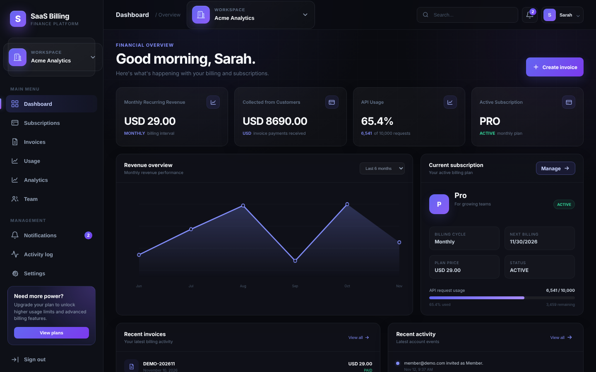
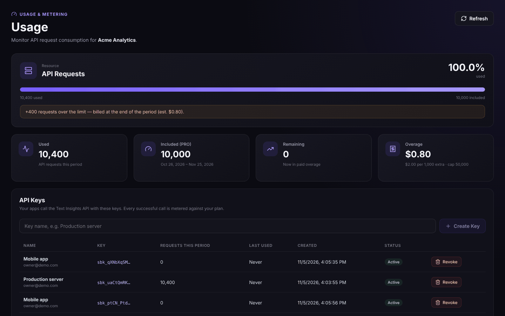
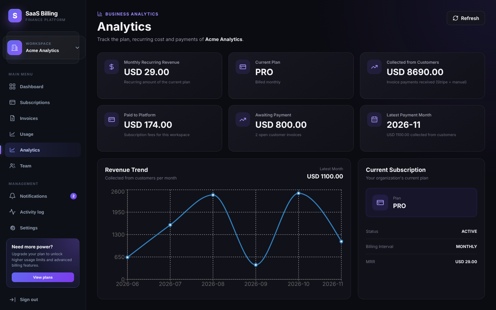
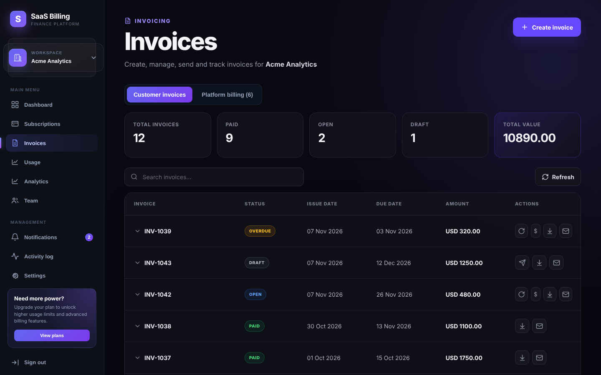
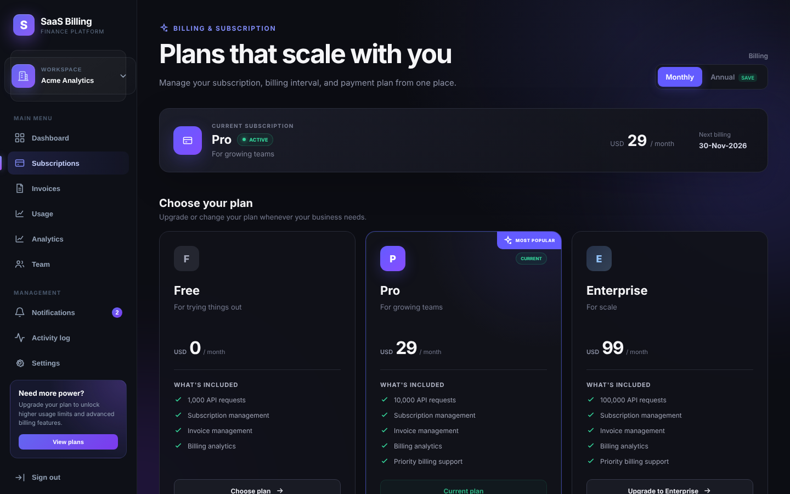
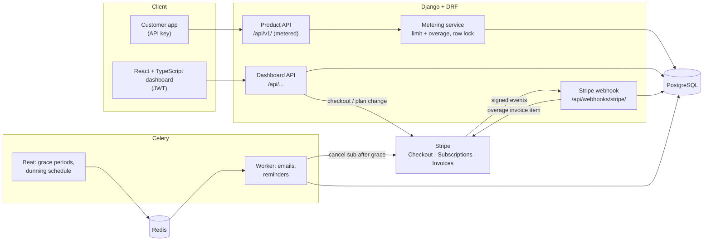
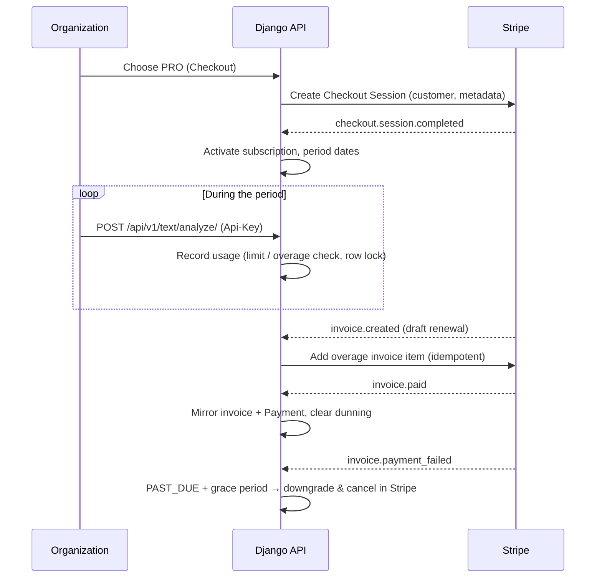

# SaaS Billing — Multi-Tenant Subscription & Usage-Based Billing Platform

[](https://github.com/MuhammadHaseeb3112/Multi-Tenant-SaaS-Billing/actions/workflows/ci.yml)


A full-stack SaaS platform that sells its own API product and bills for it:
organizations subscribe to plans with **Stripe**, call a metered API with
**API keys**, get **usage limits and paid overage**, and manage invoices,
payments, dunning, team roles and analytics — with strict **tenant
isolation**.

**Stack:** Django 6 · Django REST Framework · PostgreSQL · Celery + Redis ·
Stripe · React 19 · TypeScript · Vite · Recharts · Docker



---

## What it does

| Area | Highlights |
|---|---|
| **Multi-tenancy** | Users belong to many organizations; every query is scoped by organization; role-based access (Owner, Admin, Accountant, Member) enforced in the API. |
| **Subscriptions (Stripe)** | Stripe Checkout for FREE / PRO / ENTERPRISE (monthly or annual), plan changes, cancel / resume, one Stripe customer per org, blocks a second paid subscription (no double billing). |
| **Webhooks** | Signature-verified, stored and **idempotent** (replays are safe). Handles checkout, `invoice.paid / payment_succeeded / payment_failed / created`, subscription updated / deleted. Compatible with Stripe API `2025-03-31+` invoice shape. |
| **Failed payments** | PAST_DUE + grace period, automatic downgrade to FREE that also **cancels the Stripe subscription**; scheduled dunning reminders for overdue invoices (Celery Beat). |
| **Metered API product** | "Text Insights API" (`/api/v1/`) authenticated with hashed **API keys** (shown once, revocable). Every call is metered; limits enforced under a DB row lock (verified with concurrent requests). |
| **Usage-based billing** | Paid plans can go over their limit (price per 1,000 requests, safety cap). At renewal the overage of the closed period is added to Stripe's draft invoice — **never billed twice** (DB constraint + Stripe idempotency key). |
| **Invoices & payments** | Invoice CRUD with locked non-draft fields, PDF export (WeasyPrint), email, pay via Checkout. Stripe invoices mirrored locally; `Payment` ledger for Stripe and manual payments; backfill command. |
| **Analytics** | Per-org MRR, payments trend, total paid. Platform admin view: MRR, ARR, ARPA, plan mix, churn, revenue by method. |
| **Audit & notifications** | Audit log for sensitive actions (manual "mark paid", API keys, manual usage); in-app notifications for billing events. |

## Screenshots

| Usage, API keys & overage | Analytics |
|---|---|
|  |  |
| **Invoices** | **Plans** |
|  |  |

## Architecture



### Billing lifecycle



## Project layout

```
saas_billing_backend_api/     Django project
  apps/
    accounts/       custom user, JWT auth
    tenants/        organizations, memberships, roles, invitations
    billing/        plans, subscriptions, Stripe checkout, grace periods
    invoices/       invoices, PDF, payments ledger, dunning
    usage/          API keys, metering, overage billing, product API
    webhooks/       Stripe webhook processing
    analytics/      org + platform analytics
    audit/          audit log
    notifications/  in-app notifications
  config/           settings (base / development / production), Celery
saas_billing_frontend/        React + Vite dashboard
docs/                         deployment guide, screenshots
```

## Run it locally (Docker)

Requirements: Docker Desktop, a Stripe **test** account, Node 20.19+ (22 LTS recommended).

```bash
# 1. Backend
cd saas_billing_backend_api
cp .env.example .env             # Windows: copy .env.example .env  — then fill it in
docker compose up -d --build     # postgres, redis, web, celery, celery-beat, stripe-cli
docker compose exec web python manage.py migrate
docker compose exec web python manage.py createsuperuser

# 2. Frontend
cd ../saas_billing_frontend
npm ci
npm run dev                      # http://localhost:5173
```

Then in Django admin (`http://localhost:8000/admin/`) create the plans
`FREE`, `PRO`, `ENTERPRISE` with their Stripe price IDs, API limits and
(optionally) overage price per 1,000 requests.

Stripe webhooks are forwarded by the `stripe-cli` container; get its signing
secret once with
`docker compose run --rm stripe-cli listen --api-key <sk_test_...> --print-secret`
and put it in `.env` as `STRIPE_WEBHOOK_SECRET`.

### Call the metered API

Create a key on the **Usage** page (Owner/Admin), then:

```bash
curl -X POST http://localhost:8000/api/v1/text/analyze/ \
  -H "Authorization: Api-Key sbk_..." \
  -H "Content-Type: application/json" \
  -d '{"text": "Invoices were paid on time."}'
```

Responses carry `X-RateLimit-Limit`, `X-RateLimit-Remaining`,
`X-RateLimit-Reset` (and `X-Overage-Requests` in overage). Over the limit
without overage → `429`.

## Tests

```bash
cd saas_billing_backend_api
docker compose exec web pytest -q      # 350 tests
```

Stripe is mocked in tests. Bug fixes come with regression tests that fail
on the old code. CI (GitHub Actions) runs the backend suite against
PostgreSQL, checks for missing migrations, and type-checks, lints and
builds the frontend.

## API overview

All dashboard endpoints use JWT (`Authorization: Bearer ...`) and are scoped
by `organization_id`.

| Area | Endpoints |
|---|---|
| Auth | `POST /api/auth/register/`, `login/`, `token/refresh/`, `logout/`, `GET me/` |
| Tenants | `/api/organizations/<org>/members/`, `invitations/`, `POST /api/auth/invitations/accept/` |
| Billing | `GET /api/billing/plans/`, `.../organizations/<org>/subscription/`, `checkout/`, `subscription/change/ · cancel/ · resume/` |
| Invoices | `/api/invoices/organizations/<org>/`, `<invoice>/`, `pdf/`, `send/`, `pay/`, `payments/` |
| Usage | `/api/usage/organizations/<org>/` (summary), `api-keys/`, `overage-charges/`, `record/` |
| Product API | `POST /api/v1/text/analyze/`, `GET /api/v1/usage/` (API key) |
| Analytics | `/api/analytics/organizations/<org>/overview/`, `GET /api/analytics/platform/overview/` (staff) |
| Other | `/api/audit/...`, `/api/notifications/...`, `POST /api/webhooks/stripe/` |

### Roles

| Action | Owner / Admin | Accountant | Member |
|---|---|---|---|
| View invoices, download PDF, usage, analytics | ✅ | ✅ | ✅ |
| Create / edit / send / pay invoices, payments | ✅ | ✅ | ❌ |
| Team, subscription, checkout, API keys | ✅ | ❌ | ❌ |

## Engineering notes

- **Money safety:** unique Stripe IDs on payments, `select_for_update` on
  subscription rows, deterministic Stripe idempotency keys, webhook events
  stored before processing and only marked processed inside the same
  transaction.
- **Stripe API drift:** invoice → subscription lookup supports both the
  legacy field and the `2025-03-31+` `parent.subscription_details` shape.
- **Secrets:** API keys stored as SHA-256 hashes; `.env`, database dumps
  and Celery state are git- and docker-ignored.

Deployment checklist: [docs/DEPLOYMENT.md](docs/DEPLOYMENT.md).
